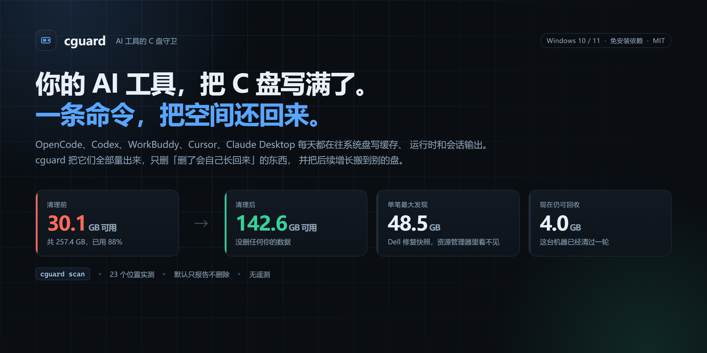
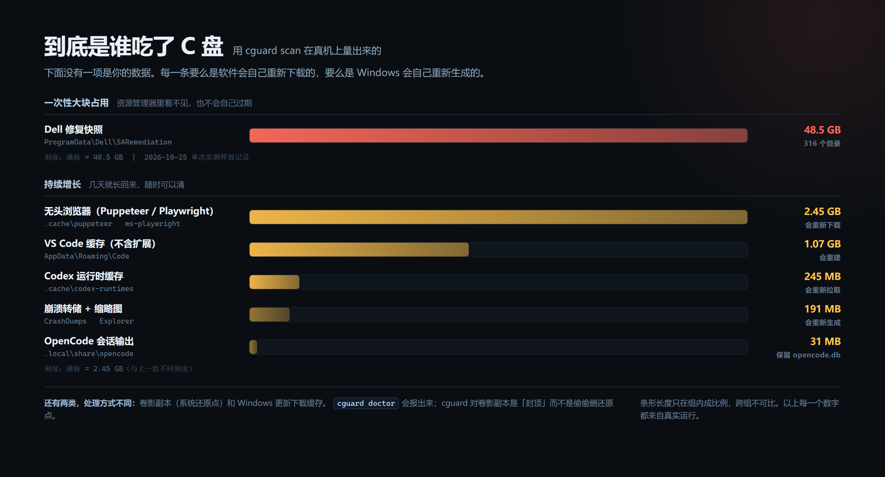
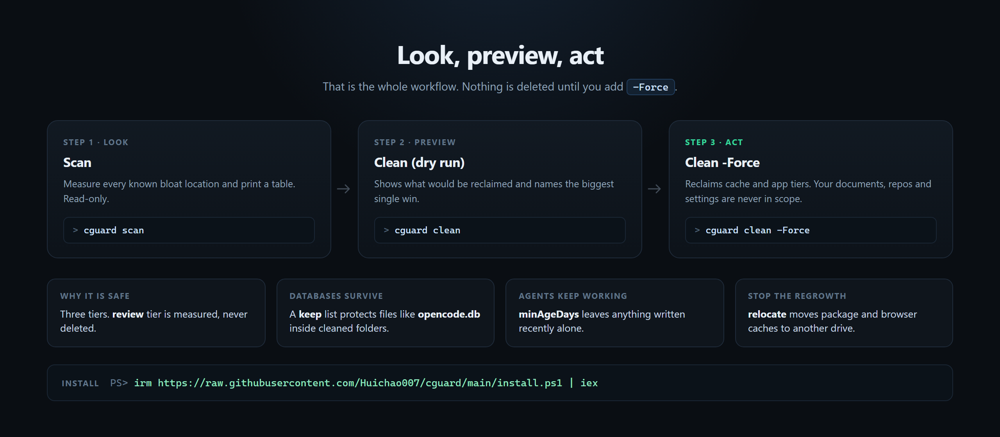

<div align="center">



# cguard

**让 Windows 的 C 盘不再被 AI 编程工具悄悄塞满。**

`Windows 10/11` · `PowerShell 5.1+` · `零依赖` · `MIT`

[English](README.md) · [更新日志](CHANGELOG.md) · [参与贡献](CONTRIBUTING.md)

</div>

---

## 先看效果

一台真实的机器：C 盘可用空间从 **30.1 GB** 回到 **142.6 GB**，没有删掉任何用户数据。



> 上图每个数字都来自 `cguard scan` 的真实输出。条形长度只在组内成比例，跨组不可比。

---

## 一、它解决什么问题

一套现代 AI 工具链，一天下来会往 C 盘写这些东西：

| 位置                                            | 为什么会涨                          |
| ----------------------------------------------- | ----------------------------------- |
| `%LOCALAPPDATA%\Temp`                           | 每次工具调用、截图、解压            |
| `~/.local/share/opencode`                       | **每个会话**的 shell 输出和工具输出 |
| `~/.cache/codex-runtimes`                       | Codex 每下一个运行时                |
| `~/.cache/puppeteer`、`ms-playwright`           | 每个自动化工具的独立 Chromium       |
| `%APPDATA%\Code`、`Cursor`、`WorkBuddy`         | 渲染层缓存、VSIX 安装包、滚动日志   |
| `%LOCALAPPDATA%\npm-cache`、`pnpm`、`uv`、`pip` | 你装过的每一个包                    |
| `C:\ProgramData\Dell\SARemediation\...`         | Dell 修复助手留着**整盘修复前映像** |
| 卷影副本（系统还原）                            | 静默占用 10-60 GB                   |

这份清单里**没有一项是你的数据**。但它们加起来，足以在你睡觉时把 30 GB 剩余
空间吃到 0，而且每一个工具的设计前提都是「删了我会重新下载」。

## 二、和腾讯电脑管家到底比什么

**必须先说清楚：cguard 不是安全软件，不能替代电脑管家。** 谁要说能替代，那是
在骗人。两者的能力根本不在一个面上：

| 能力                                        | 腾讯电脑管家   | cguard                     |
| ------------------------------------------- | -------------- | -------------------------- |
| 杀毒 / 木马查杀                             | 有（TAV 引擎） | **没有**                   |
| 实时防护 / 主动防御                         | 有             | **没有**                   |
| 弹窗拦截                                    | 有             | **没有**                   |
| 软件管家 / 一键卸载                         | 有             | **没有**                   |
| 驱动更新 / 硬件检测                         | 有             | **没有**                   |
| 垃圾清理、微信/QQ 专清                      | 有             | 部分重叠                   |
| 图形界面                                    | 有             | **没有，纯命令行**         |
| **认识 AI 工具链的缓存**                    | **不认识**     | 内置 23 条规则             |
| **能说清 `~/.local/share/opencode` 是什么** | 不能           | 能，还知道留 `opencode.db` |
| **Dell 修复快照（可达几十 GB）**            | 不报           | `doctor` 主动排查          |
| **把缓存永久搬到 D 盘**                     | 不能           | `relocate` 一条命令        |
| **按「删了要付多大代价」分档**              | 一刀切         | safe / apps / review 三档  |
| **默认不删，先报数字**                      | 默认清         | 默认 dry-run               |
| **审计日志（每次动了什么）**                | 有             | 有，单行可追溯             |
| 自身占盘与常驻内存                          | 较大           | 单文件脚本，无常驻进程     |

一句话：

> **电脑管家防的是「病毒」，cguard 防的是「你自己的工具链」。**

真正的用法是**两个都装**：管家管安全，cguard 管磁盘。它们不冲突。

## 三、安装（一行命令）

### 方式 A：一行命令（推荐，无需 git、无需管理员）

打开 PowerShell，粘贴：

```powershell
irm https://raw.githubusercontent.com/Huichao007/cguard/main/install.ps1 | iex
```

装完会：装到 `%LOCALAPPDATA%\Programs\cguard`、写一个 `cguard.cmd` 启动器、
把目录加进用户 PATH、跑一次扫描给你看结果。

**关掉，开一个新终端**，然后：

```powershell
cguard scan
```

> 国内网络访问 `raw.githubusercontent.com` 可能不通。若上面那条失败，用方式 B。

### 方式 B：手动下载压缩包

1. 打开 https://github.com/Huichao007/cguard → 绿色 `Code` → `Download ZIP`
2. 解压到任意位置，比如 `D:\Tools\cguard`
3. 在该目录打开 PowerShell：

```powershell
.\install.ps1
```

### 方式 C：直接跑，不安装

```powershell
git clone https://github.com/Huichao007/cguard.git D:\Tools\cguard
cd D:\Tools\cguard
.\cguard.ps1 scan
```

### 卸载

```powershell
cguard watch -Uninstall          # 先删计划任务
.\install.ps1 -Uninstall         # 再删目录和 PATH
```

（`-Uninstall` 需要你能找到 install.ps1，或用 `install.ps1` 的完整路径。）

## 四、怎么用（四个命令）



| 命令       | 作用                                        | 会删东西吗         |
| ---------- | ------------------------------------------- | ------------------ |
| `scan`     | 量出每个位置占多少                          | **不删**           |
| `clean`    | 默认 dry-run，只报能省多少；`-Force` 才动手 | 只有 `-Force` 才删 |
| `doctor`   | 解释「为什么满了」                          | **不删**           |
| `relocate` | 把缓存永久搬离 C 盘                         | **不删**           |
| `watch`    | 注册定时任务，只在空间不足时清理            | 只在低空间时删     |

### 第一次用，照这个顺序

```powershell
cguard scan                 # 1. 先看盘去哪了
cguard clean                # 2. 看能省多少（不会删任何东西）
cguard clean -Force         # 3. 确认无误再真删
cguard doctor               # 4. 查为什么满、还有什么没排查到
```

需要管理员权限的目标（Windows Temp、更新缓存、`$WinREAgent`、Dell 快照）：

```powershell
cguard clean -Force -Admin   # 弹一次 UAC，全清
```

### 常用组合

```powershell
cguard clean -Force -Tier safe                    # 只清纯缓存，最保守
cguard clean -Force -Only opencode-data           # 只清 OpenCode
cguard clean -Force -ReportPath D:\report.md      # 出 Markdown 报告
cguard clean -Auto                                # 只在低空间时动手
cguard watch -Install -EveryHours 6               # 装定时巡检
cguard watch -Status                              # 看任务状态和最近审计
```

### 三档分级，为什么重要

- **safe** — 纯缓存或临时文件。删了最多重新下载或冷启动一次。
- **apps** — Agent 的运行时和模型。可以删，但下次启动会重新拉。
- **review** — **你的数据**：会话、配置、已装扩展、容器磁盘、页面文件。
  **永远不删**，只有 `-Deep` 才会被列出来看。

这是它和「一键清理」工具最大的区别：它知道哪些不能碰。

## 五、安全模型

这工具会删文件，所以规则必须写死：

1. **默认 dry-run。** 不加 `-Force`，`clean` 只打印数字。
2. **永不越界。** 路径来自 `config\targets.json`，没声明的目标不可能被删。
3. **`keep` 优先。** 目标里 `keep` 列出的文件名一定保留——`opencode.db`
   就是这样在 `clean -Force` 下活下来的。
4. **遵守 `minAgeDays`。** N 天内写过的缓存不动，避免删掉 Agent 正在用的文件。
5. **锁定文件跳过，不强制。** 正在被占用的文件只统计不硬删，也不杀进程。
6. **`review` 档只读。** 这一档存在的意义是「量出来」，不是「清干净」。
7. **`-Auto` 有地板。** 定时任务在空间充足时**什么都不做**。

自测覆盖以上每一条，32 项断言，全在临时沙箱里跑：

```powershell
powershell -NoProfile -ExecutionPolicy Bypass -File .\tests\test-cguard.ps1
```

安装器另有 16 项测试，包括「站在安装目录里执行卸载」这种真实场景：

```powershell
powershell -NoProfile -ExecutionPolicy Bypass -File .\tests\test-install.ps1
```

## 六、自己加一条规则

`config\targets.json` 就是全部知识库。加一条：

```json
{
  "id": "my-agent-cache",
  "tier": "safe",
  "group": "ai-agents",
  "label": "我的 Agent 缓存",
  "description": "下载的模型分片。",
  "paths": ["%LOCALAPPDATA%\\MyAgent\\cache"],
  "minAgeDays": 14,
  "keep": ["config.json"],
  "reclaim": "delete-contents"
}
```

`reclaim` 四种模式：

| 模式              | 行为                                               |
| ----------------- | -------------------------------------------------- |
| `delete-contents` | 清空目录内容，保留目录本身                         |
| `subdirs`         | 只清列出的子目录（用于「数据库和缓存混住」的目录） |
| `cmdlet`          | 调用官方命令清理，不手动删文件                     |
| `report-only`     | 只量不删                                           |

拿不准就用 `review`——它只会被量出来，不会出事。

## 七、实测结果

这台机器上，C 盘可用空间从不足 **30 GB** 恢复到 **142.6 GB**。

最大的一笔，也是绝大多数人根本不会想到去查的：

| 动作                                     | 释放             | 依据                                               |
| ---------------------------------------- | ---------------- | -------------------------------------------------- |
| Dell SupportAssist 修复快照              | **单次 48.5 GB** | 可用空间 96.67 GB → 145.21 GB，删掉 316 个快照目录 |
| 日常：Agent 缓存、浏览器内核、编辑器缓存 | **按需 3-4 GB**  | 本机 `cguard scan` 实测                            |

`SARemediation\SystemRepair\Snapshots` 是驱动/BIOS 修复后留下的整盘修复前映像。
资源管理器里看不到，不会自己过期，能有几十 GB。`cguard doctor` 会点名排查它、
`clean -Force -Admin` 负责清掉。

同一台机器上另外两个发现，都是 `doctor` 报出来的，不是猜的：

- 卷影副本占了几十 GB 的系统还原点。用
  `vssadmin resize shadowstorage /for=C: /on=C: /maxsize=8GB` 把它封顶。
- 缩略图、Windows 更新下载、`$WinREAgent` 暂存，零零散散又有几个 GB。

cguard 不认领它没释放的空间：先 `scan`、再 `clean -Force`，审计日志会把两个
数字都记下来。

## 八、环境要求

- Windows 10 / 11
- PowerShell 5.1（系统自带）——不需要装模块、不需要管理员就能 scan
- 管理员只在清 `%WINDIR%\Temp`、Windows 更新缓存、`$WinREAgent`、卷影副本、
  Dell 快照时才需要

## 九、它不做什么

- 不碰你的文档、项目、git 仓库、照片、下载。
- 不删 VS Code / Cursor 扩展，不删浏览器配置、Cookie、登录态。
- 不压缩 Docker / WSL 的 `ext4.vhdx`——那需要
  `wsl --manage <distro> --set-sparse true`，cguard 只报告大小。
- 不装任何东西、不回传数据、不带遥测。
- **不杀毒、不防木马、不拦弹窗**——那是电脑管家的活。

## 十、维护与反馈

- **版本**：见 [CHANGELOG.md](CHANGELOG.md)，遵循语义化版本。
- **升级**：重跑一次安装命令即可（加 `-Force` 覆盖）：

  ```powershell
  irm https://raw.githubusercontent.com/Huichao007/cguard/main/install.ps1 | iex
  ```

  或本地：`.\install.ps1 -Force`

- **报 bug**：请附带目标 `id`、被误删的东西、以及审计日志里对应那一行
  （`%LOCALAPPDATA%\cguard\cguard.log`）。那一行是唯一能追溯「这次动了什么」
  的凭据，所以 dry-run 也会写。
- **加规则**：欢迎 PR，改 `config/targets.json` 即可，测试会校验 schema。

## 许可证

MIT。拿去用、拿去改、拿去塞进你自己的工具链。
